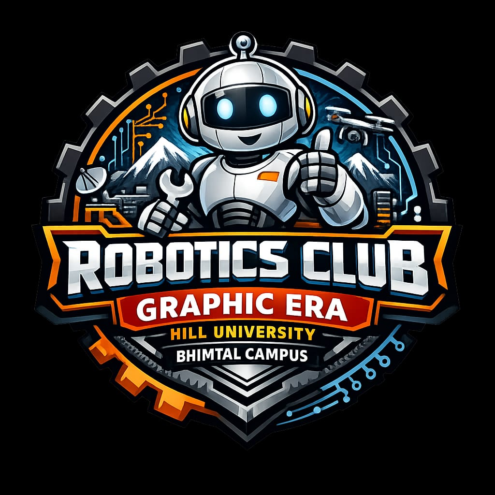
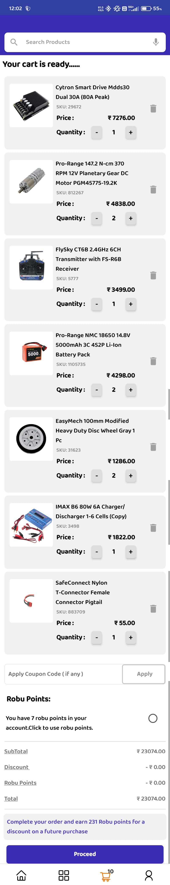
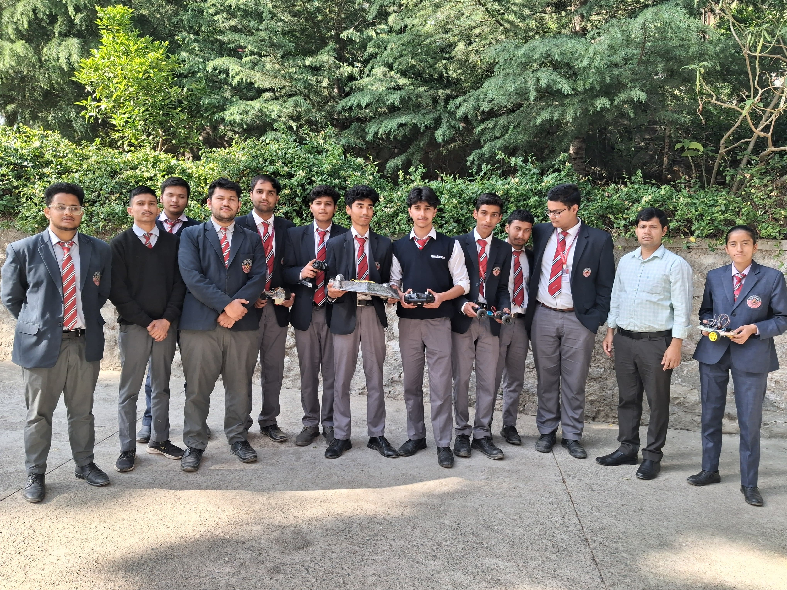
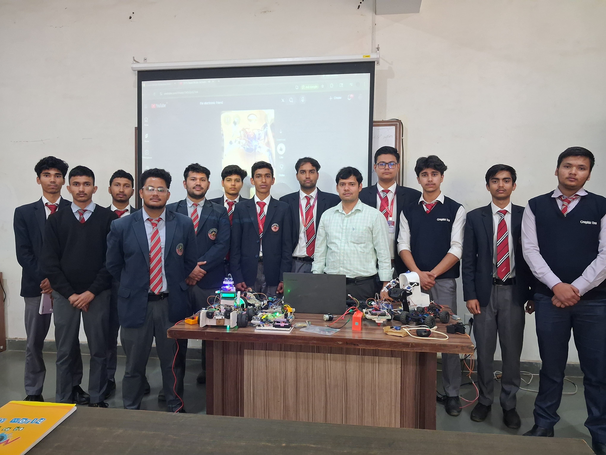
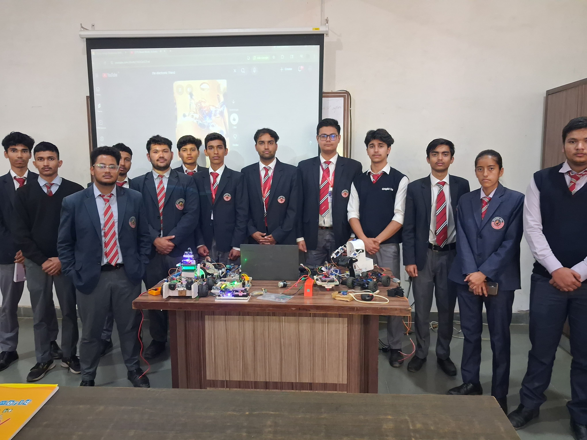
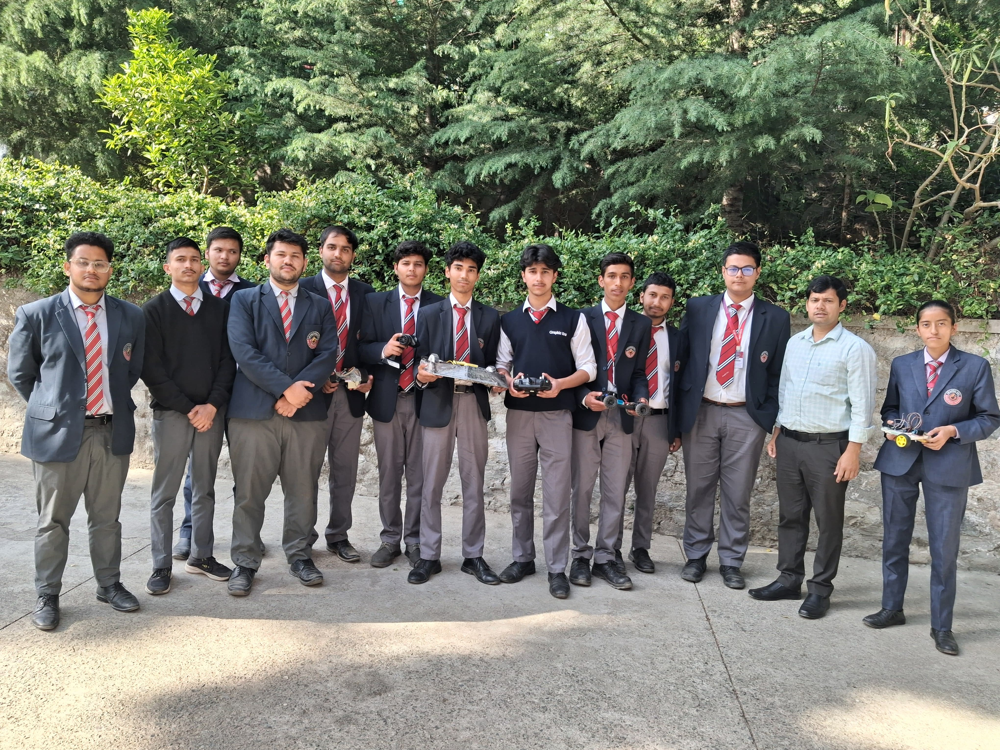
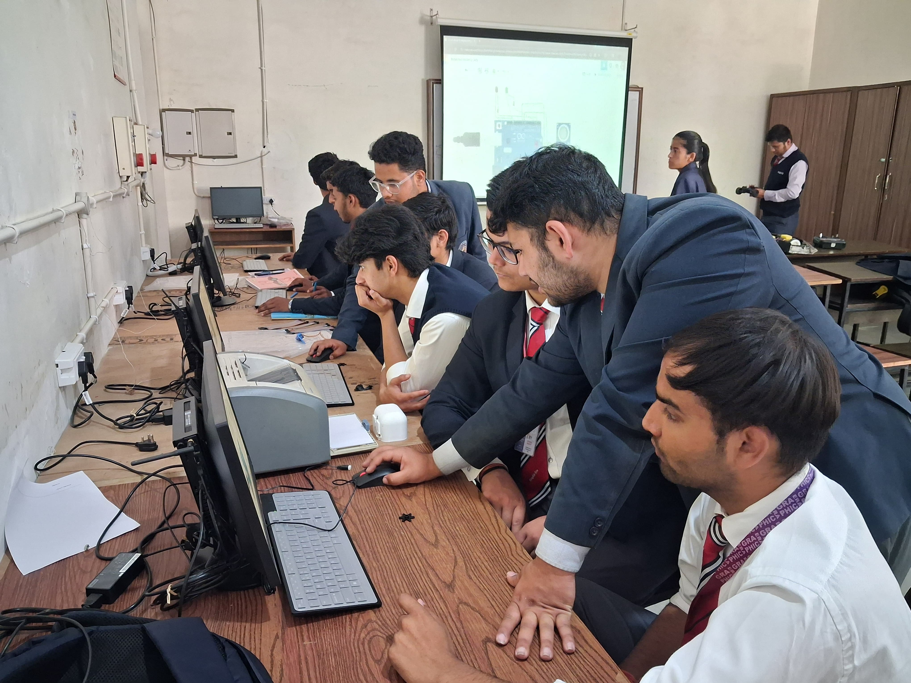
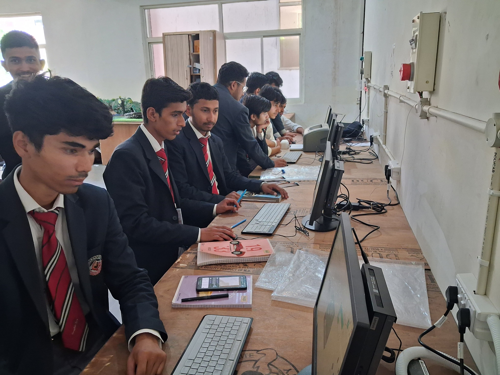

# Robotics & Automation Club Engineering Portfolio: Combat Robotics, Race Engineering & STEM Curriculum

[]()
[]()
[-red.svg?style=for-the-badge)]()
[]()
[-success.svg?style=for-the-badge)]()
[](https://opensource.org/licenses/MIT)

> **University Leadership & Technical Showcase | Graphic Era Hill University (B.Tech ECE 2023–2027)**  
> **Author & President:** Parth Dalakoti  
> **Contact:** `parthdalakoti482@gmail.com` | [LinkedIn](https://linkedin.com/in/parthdalakoti)

---

## ⚡ Executive Leadership Summary

As **President of the Robotics & Automation Club at Graphic Era Hill University (Bhimtal Campus)**, I lead university robotics teams, design competitive combat and race bots, and spearhead engineering workshops:
1. **RoboWar Combat Bot (5th Position — Dehradun Campus):** Designed and piloted a heavy-torque combat robot with custom armor chassis, dual Cytron / high-amp motor drivers, 3S/4S LiPo power distribution, and 2.4 GHz FlySky AFHDS 2A telemetry.
2. **Robo Race Bot (6th Position):** Engineered an agile speed vehicle with low center-of-gravity weight distribution, precision differential steering, and high-RPM motor gearing.
3. **Robotics Workshops & Mentorship:** Personally organized and delivered two university-wide practical robotics workshops for 1st and 2nd-year engineering students, covering microcontroller architecture, Tinkercad virtual circuits, C++ firmware, and hands-on robot car assembly.
4. **Smart Cleaning Robot Project:** Developed an automated municipal street-cleaning prototype presented for smart city environmental cleanup.

---

## 📸 Media & Competitive Showcase

| Official Club Banner | RoboWar Combat Bot Chassis |
| :---: | :---: |
|  |  |

---

## 📂 Repository Contents

```text
├── competitions/
│   └── robowar-5th-rank/       # Technical budget, chassis photo, FlySky radio configuration
├── workshops/
│   └── Arduino_Robotics_Workshop_Curriculum.pptx  # 100+ slide curriculum for junior mentoring
├── projects/
│   └── smart-cleaning-robot/   # Smart Cities cleaning bot report & presentation
├── docs/                       # Official Club Constitution & Technical Charter
└── media/                      # Official club banners and competition photographs
```

---

## 👨‍💻 Engineering Author & Club President
**Parth Dalakoti**  
*President, Robotics & Automation Club*  
*B.Tech in Electronics & Communication Engineering (2023–2027)*  
*Graphic Era Hill University (GEHU), Bhimtal Campus*  
*Contact:* `parthdalakoti482@gmail.com`

---

## 🏛️ Executive Leadership & Faculty Advisory Roster

<table>
  <tr>
    <td width="50%" align="center">
      
      <br />
      <b>Executive Leadership Body</b>
      <br />
      <i>President Parth Dalakoti and Core Officers in University Blazers</i>
    </td>
    <td width="50%" align="center">
      
      <br />
      <b>Faculty Advisory & Department Mentorship</b>
      <br />
      <i>Club Leadership with Faculty Advisor at the Engineering Showcase</i>
    </td>
  </tr>
  <tr>
    <td width="50%" align="center">
      
      <br />
      <b>Live Demonstration Bench in University Seminar Hall</b>
      <br />
      <i>Active testbench with LED beacon rovers and live sensor telemetry</i>
    </td>
    <td width="50%" align="center">
      
      <br />
      <b>Campus Outdoor Robotics Cohort</b>
      <br />
      <i>GEHU Robotics & Automation Club on Campus with Competition Rovers</i>
    </td>
  </tr>
  <tr>
    <td width="50%" align="center">
      
      <br />
      <b>Hands-On Circuit & Firmware Mentorship</b>
      <br />
      <i>Parth Dalakoti leading embedded systems seminar in the computer lab</i>
    </td>
    <td width="50%" align="center">
      
      <br />
      <b>Workstation Microcontroller Programming</b>
      <br />
      <i>Students simulating and programming autonomous firmware in the CAD lab</i>
    </td>
  </tr>
</table>
